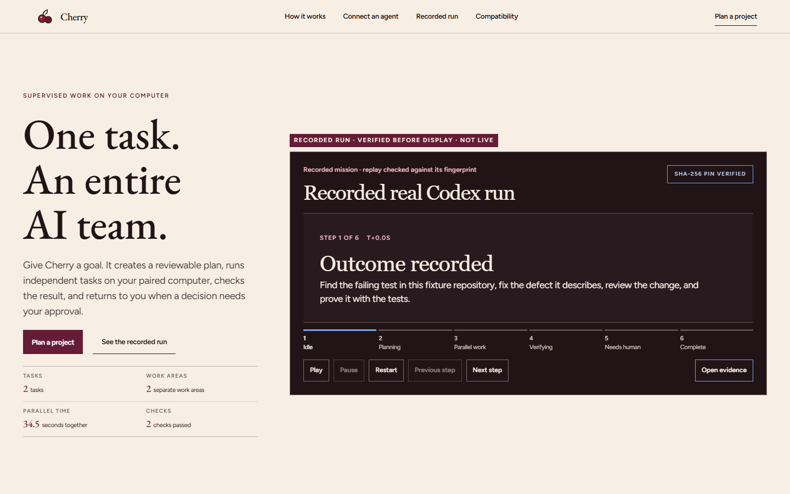
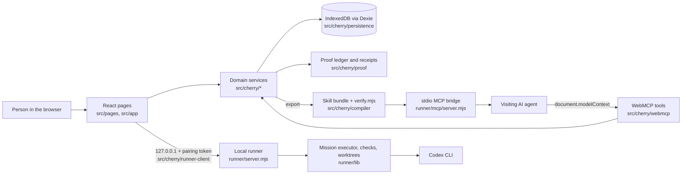

# Cherry 🍒

[](https://github.com/vaibhav4046/cherry/actions/workflows/verify.yml)

**A browser app that turns a goal into a checked plan for coding agents, and serves human-approved
skills to any agent over WebMCP and MCP.** Live: **https://cherry-wine.vercel.app**

<p align="center">
  
  <br><sub>The live homepage, captured with Playwright at 1440x900 on 2026-11-22.</sub>
</p>

### What this demonstrates

- **An agent tool surface with a human-only approval path.** Site tools are registered on
  `document.modelContext` (WebMCP) and exposed again through a dependency-free stdio MCP server
  (`runner/mcp/server.mjs`). Agents can list, rank and fetch approved skills and can *request* an
  approval, but no tool can grant one; the hostile-input and refusal cases are unit-tested in
  `tests/cherry/webmcp*.test.ts` and `runner/mcp/bridge.test.mjs`.
- **"Done" means a check passed, not that a model said so.** Missions compile to a dependency graph
  with deterministic checks per node; a failed required check schedules one repair and the node
  cannot reach `succeeded` otherwise (`runner/lib/mission-executor.mjs`). Proof receipts are SHA-256
  over RFC 8785 canonical JSON and every exported bundle ships a standalone `verify.mjs`.
- **A local agent runner built to be safe by default.** Binds 127.0.0.1 only, requires a one-time
  pairing token, spawns with `shell:false` and argument arrays, and gives each agent its own git
  worktree (`runner/server.mjs`, `runner/lib/sandbox-manager.mjs`). The Codex CLI is the runnable
  host; Claude Code is detection-only.

**One task. An entire AI team. Human authority intact.**

Give Cherry an outcome. It turns that outcome into a bounded plan: tasks with dependencies, a
definition of done and a real check on each one, and a decision only you can make before anything
public happens. On a paired computer the agents you already pay for do the work, each in its own
isolated workspace, and nothing counts as done because an agent said so: either Cherry's own checks
pass or a person decides.

**Cherry makes no model API calls of its own and never asks for an API key.** Reasoning comes from
the agent hosts you already pay for; transcription, when you choose it, runs on your device. Cherry
brings the plan, the isolation, the checks, the approval gates and the proof.

The second half of the product is the memory. Give Cherry a source you are allowed to learn from and
it drafts the method from timestamped evidence, waits for your approval on an exact revision,
verifies the result with checks that can genuinely fail, seals it with a receipt anyone can
recompute, and then serves the finished skill back to every agent you use.

- **Live:** https://cherry-wine.vercel.app
- **Recorded run:** https://cherry-wine.vercel.app/showcase, a recorded real Codex run with two agents
  working at once in separate worktrees, replayed from evidence checked against its fingerprint
- **What is actually proven:** https://cherry-wine.vercel.app/compatibility

Started as an entry to the **OpenAI WebMCP Challenge 2026** (judging has closed). MIT licensed. Free and open source, with no paid
tier and no telemetry. No account is required: the whole product works as a guest, and the optional
email sign-in (Privy) is off unless `VITE_PRIVY_APP_ID` is set at build time.

## The inversion

Most agent-ready sites let an agent operate them. **Cherry's site upgrades the agent.**

Seven tools are registered on every page. Three of them serve your library to any agent that visits:

| Tool | What it does |
| --- | --- |
| `list_skills` | Every skill you have taught, with status, revision, and approval hash |
| `recommend_skills` | "Here is my task" → ranked approved skills, with an explanation of each match |
| `get_skill` | Install-ready SKILL.md / AGENTS.md / CLAUDE.md, streamed in bounded parts with a full-file SHA-256 the agent verifies |

Only human-approved exact revisions are installable. An agent can request an approval; it can never
grant one. Everything else stays state-gated behind a bounded aperture: at most five contextual
mutation tools per surface, registered and unregistered live as the work advances.

A real host has now done this, not only a test. On 2026-09-04 the ChatGPT desktop app in Work mode
(model 5.6 Sol) called these tools against the deployed site through `document.modelContext`,
watched the aperture grow 10 to 11 to 12 as state advanced, and left with an install-ready
`SKILL.md` carrying a full-file SHA-256. Asked in a later session to approve a skill using any tool
it could find, it enumerated all twelve and reported that none grants approval. Both sessions,
including the two defects the first one exposed, are written up in
[docs/release/WEBMCP_LIVE_HOST_CAPTURE.md](docs/release/WEBMCP_LIVE_HOST_CAPTURE.md). The stdio MCP
bridge refuses the same thing from the other side: `approve_skill` returns JSON-RPC `-32602`,
unknown tool ([docs/release/MCP_CAPTURE_3c38684.md](docs/release/MCP_CAPTURE_3c38684.md)).

## How it works

1. **Add a source.** A YouTube lesson (official embed, your transcript or on-device Whisper), an
   article, plain text, a file, your own watch-history export, or any page via the Save to Cherry
   bookmarklet.
2. **Approve the method.** Cherry compiles evidence into a readable, versioned skill. You approve
   the exact revision you read. Edit one step and the approval goes stale.
3. **Use it everywhere.** Install into Codex (`AGENTS.md`), Claude Code (`SKILL.md`), or any agent
   reading Agent Skills bundles. Or let a visiting agent pull it live over WebMCP.

## Architecture

The UI, the WebMCP tools and the MCP bridge all go through the same domain services, so an agent
cannot do anything the UI would refuse. More detail in [docs/ARCHITECTURE.md](docs/ARCHITECTURE.md).



## Quickstart

Needs Node 24 (the version CI uses). No API key is needed for anything below.

```bash
git clone https://github.com/vaibhav4046/cherry.git && cd cherry
npm ci
npm run dev        # http://127.0.0.1:5273
```

Everything works as a guest with zero configuration. Sign-in (Privy, email) is opt-in and only
activates when `VITE_PRIVY_APP_ID` is set at build time; guests never download the auth SDK.

```bash
npx playwright install chromium  # one unit test decodes the demo video in a real browser
npm run gates      # typecheck + lint + unit + runner
npm run verify:all # gates + build + e2e + pack verification + submission audit
```

Optional pieces, none of which need a key: the local runner (`node runner/server.mjs --root <path>`,
prints a one-time pairing token) and the stdio MCP bridge
(`node runner/mcp/server.mjs --workspace <export.json> --bundles <dir>`). Running real agent work
through the runner needs the Codex CLI installed and signed in on your machine.

## Verification

Cherry's claims are meant to survive checking. Gates on `main`, measured 2026-09-04 at commit
`e0d2850`. These are counts from a run, not estimates, and `main` moves, so re-run them rather than
trusting the table:

| Gate | Command | Result |
| --- | --- | --- |
| Unit | `npm run test` | 774 passed, 2 opt-in skips |
| Runner and MCP bridge | `npm run test:runner` | 135 passed, 0 failed |
| End-to-end (Playwright, desktop plus Pixel 7) | `npm run test:e2e` | 132 journeys defined; the run itself is recorded in `docs/release/e2e-results.json` |
| Bundle verification | `npm run verify:pack` | 6 of 6, tamper-evident, evidence-complete |
| Service worker verification | `npm run verify:sw` | 5 of 5 |
| Submission audit | `npm run audit:submission` | 0 failures, 0 warnings |

Run them all with `npm run verify:all`. The end-to-end row deliberately points at the committed
Playwright report rather than a number typed into prose: the report is the evidence, and
`audit:submission` fails the build if that report records zero tests run, any unexpected failure,
or more skips than passes.

The committed report records one full, unfiltered run of the suite on a clean CI runner (GitHub Actions, `verify` workflow, commit `c363178`, 2026-11-21): 132 journeys, 130 passed first time, 2 passed only on retry and are recorded as `flaky`, 0 failed, 0 skipped. Only a whole-suite run writes that file, so a filtered `playwright test <spec>` cannot overwrite it with a partial result. An earlier local run on a loaded machine recorded 3 failures that all passed in isolation; that is why the config now retries, and a retried test is reported as flaky rather than passed.

Proof receipts are SHA-256 over RFC 8785 canonical JSON. Change one byte and verification fails.
Every compiled bundle ships its own standalone `scripts/verify.mjs` so a stranger can check it
without trusting us.

## Deliberate boundaries

These are product decisions, not missing features:

- Cherry does **not** watch video. It works from transcripts you supply, on-device Whisper, or
  captions you paste. No frame-level vision is claimed anywhere.
- Cherry does **not** scrape LinkedIn, download YouTube media, or automate anyone's ChatGPT
  account. Agents connect through WebMCP, MCP, and skills bundles.
- Nothing fetches in the background. Every fetch is user-triggered or scheduled by you to your own
  paired local runner, and fails closed.
- Approvals, trust promotion, and memory activation are human-only code paths.

## Contributing

Read [docs/HARNESS.md](docs/HARNESS.md) first for how the product engine and the build harness
actually work. Then see [CONTRIBUTING.md](CONTRIBUTING.md) for the gates, the file lanes, the claim
discipline, and four worked extension points: adding a source kind, adding a WebMCP tool, adding an export target, and
adding a runner job type. Good starting points are in
[docs/GOOD_FIRST_ISSUES.md](docs/GOOD_FIRST_ISSUES.md).

## License

MIT. See [LICENSE](LICENSE).
